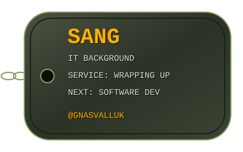
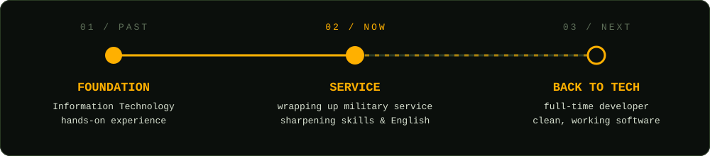
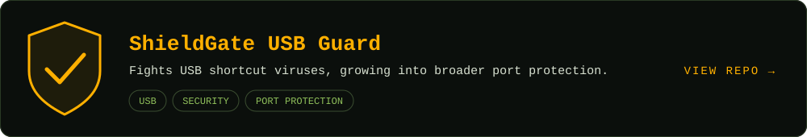
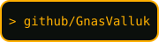
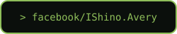

  

 

<table>
<tr>
<td width="42%" valign="middle" align="center">
  
</td>
<td valign="middle">

### `> about --sang`

- **Background in Information Technology**, with hands-on experience before and during my military service
- **Wrapping up my service**, getting ready to jump back into tech full-time
- **Sharpening my skills** (and my English) to make the most of what's next
- **Open to connecting** with other developers and to new opportunities
- I like turning **simple ideas into clean, working software**

</td>
</tr>
</table>

 

### `> mission --log`

  

 

### `> project --featured`

  

 

### `> connect --open`

  
  &nbsp;
  

 

  

